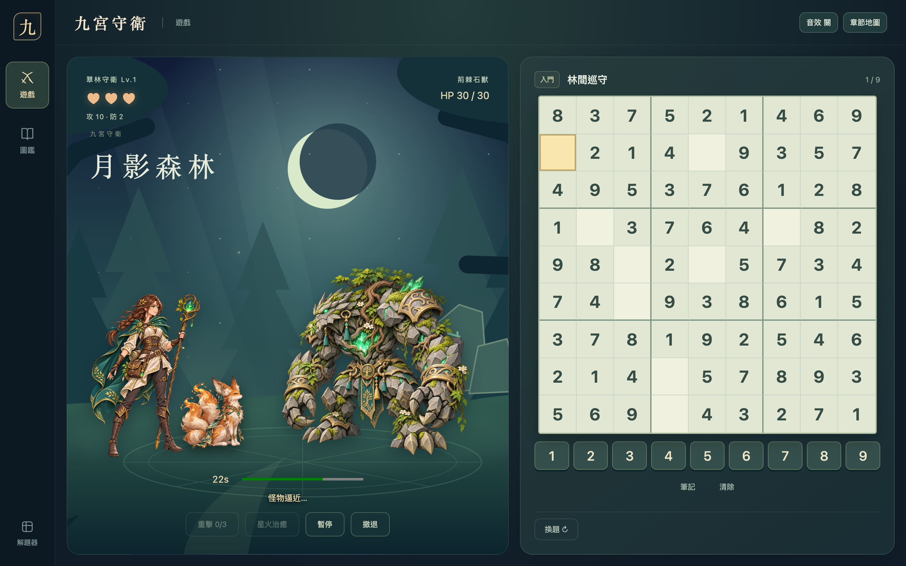

# 九宮守衛

以數獨為核心的冒險遊戲，在怪物逼近前解開盤面，與夥伴一起挑戰守關 Boss。

## 玩法

在空格填入 **1～9**，讓每一列、每一欄及每個 **3×3 宮格**都包含 1～9，且數字不重複。題目已給的數字不能更改。

## 遊戲特色

- 三章九關，探索森林、冰霜遺跡與流沙星海。
- 解鎖角色、夥伴與裝備，搭配技能迎戰 Boss。
- 重新挑戰更換題目，保留冒險進度。

## 開始遊玩

目前需在自己的電腦啟動，請依照 [啟動指南](DEVELOPMENT.md#啟動) 開啟遊戲。

進度自動保存在目前瀏覽器；清除網站資料或換裝置不會保留進度。

想解自己的題目？側邊欄的「解題器」也能貼上數獨、查看解答。
