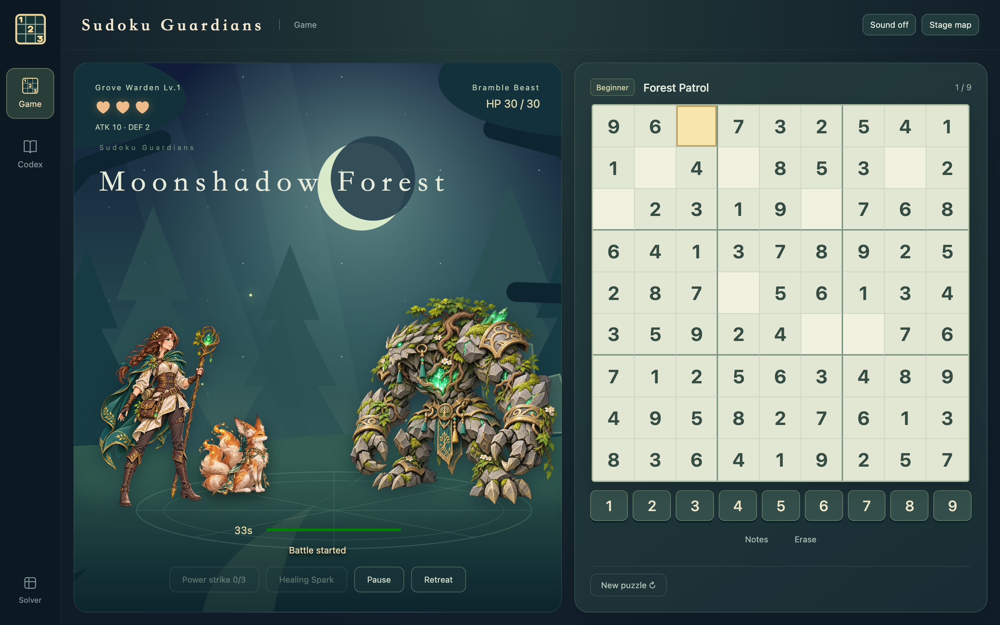

# Sudoku Guardians

Solve Sudoku puzzles to hold back monsters and take on each stage’s boss with your companion.

## How to play

Fill each empty cell with a digit from **1 to 9**. Each row, column, and **3×3 box** must contain every digit exactly once. The starting clues are fixed.

## Start playing

Follow the [launch guide](DEVELOPMENT.md#launch) to run the game on your computer. Your progress is saved in the browser you use to play. Clearing site data removes your save.

To solve a puzzle of your own, open **Solver** in the sidebar and paste it in.
